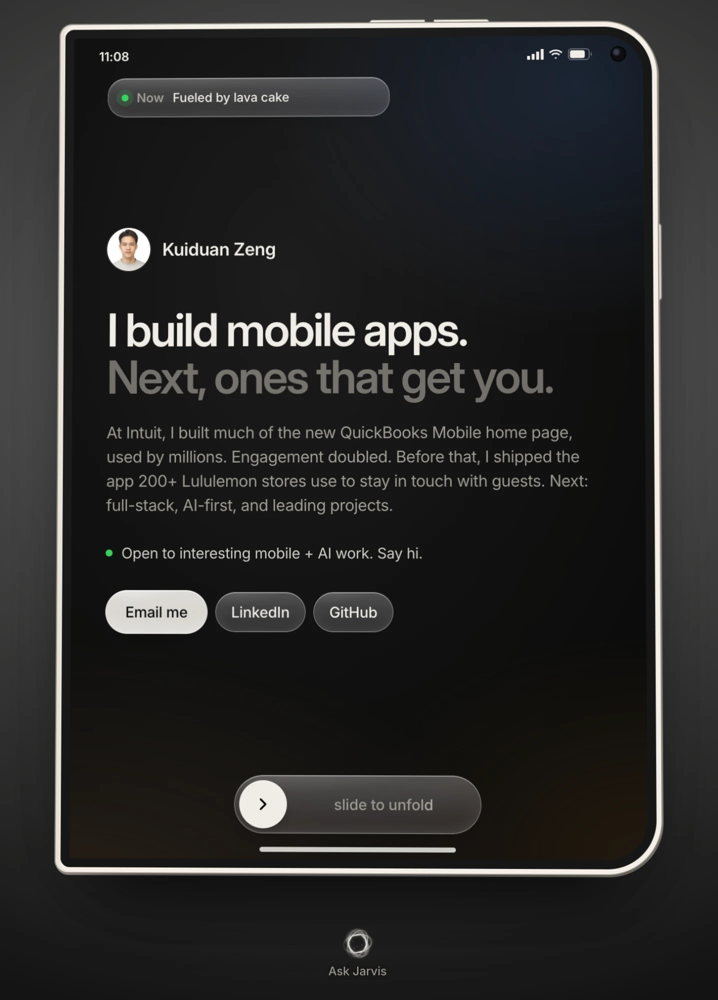
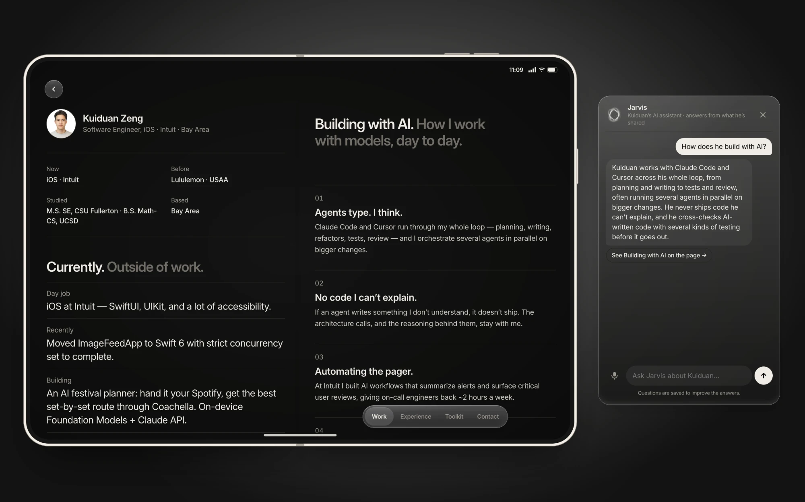

# kuiduanzeng.com

My personal site, built as a foldable phone. Slide to unfold it into a two-pane screen, or ask Jarvis, an AI assistant that answers questions about me by voice or text.

**[kuiduanzeng.com](https://kuiduanzeng.com)** · Astro · TypeScript · Cloudflare Workers + D1 · Claude API · Azure TTS

<p>
  
  
</p>

## Highlights

- **Foldable layout.** At ≥1000×640 the page is a folded phone. Slide, scroll, or follow any in-page link and it unfolds: About on the left, the sections on the right. Phones and no-JS get a normal page. Logic is in `src/scripts/fold.ts`, geometry in `src/styles/global.css`.
- **Jarvis.** Claude Haiku answers from `/kb.json` (built from the confirmed content in `src/data/*.ts`) plus Q&A I write on `/admin`. Questions it can't answer are logged and emailed to me in a daily digest, and answers can be read aloud with Azure neural TTS. Back end: a Cloudflare Worker + D1 in `worker/`.

## Run locally

```bash
npm install
npm run dev       # site
npm run build     # output in dist/
npm run og        # regenerate public/og-image.png
```

To run Jarvis locally too:

```bash
cd worker && npm install && cp .dev.vars.example .dev.vars   # add ANTHROPIC_API_KEY, or set MOCK_MODEL=1
npm run db:init:local                                        # once
npm run dev                                                  # http://localhost:8787 (admin at /admin)
```

Then in the site root run `cp .env.example .env` and `npm run dev`. The Jarvis button only renders when `PUBLIC_ASSISTANT_API` is set.

## Editing content

- Content lives in `src/data/*.ts`, design tokens in `src/styles/global.css`.
- Unconfirmed content appears only in `npm run dev` (dashed boxes and CONFIRM tags) and is left out of production builds: `featured.ts` / `ai.ts` set to `null`, `now.ts` lines with `confirmed: false`, and `profile.openTo` set to `null`.
- Everything in the knowledge base, `/admin` Q&A included, can be repeated to visitors, so write only what you'd say publicly.

## Deploy

The site deploys to GitHub Pages on push (`.github/workflows/deploy.yml`, with the Pages source set to "GitHub Actions"). `public/CNAME` points at kuiduanzeng.com.

<details>
<summary>Jarvis Worker setup</summary>

1. `cd worker && npx wrangler login && npx wrangler d1 create assistant`, then paste the `database_id` into `wrangler.toml`.
2. `npm run db:init:remote`.
3. Secrets: `npx wrangler secret put` each of `ANTHROPIC_API_KEY`, `RESEND_API_KEY`, `TURNSTILE_SECRET`, `SESSION_SECRET` (any long random string), and `ADMIN_EMAIL` (the email you sign in to Cloudflare Access with).
4. `npm run deploy`. Attach `api.kuiduanzeng.com` (or note the Worker URL) and set `ADMIN_URL` in `wrangler.toml`.
5. Cloudflare Zero Trust → Access: add a self-hosted app for `<worker host>/admin` and `<worker host>/api/admin/*` that allows only your email. Put the team domain and AUD tag in `ACCESS_TEAM_DOMAIN` / `ACCESS_AUD`, then redeploy. Without these and `ADMIN_EMAIL`, `/admin` refuses every request.
6. GitHub repo → Settings → Variables: set `PUBLIC_ASSISTANT_API` (the Worker URL) and `PUBLIC_TURNSTILE_SITE_KEY`, then push.
7. Set a monthly spend limit in the Anthropic Console.
8. Optional voice: create an Azure Speech resource (free F0 tier), then `npx wrangler secret put` `AZURE_SPEECH_KEY` and `AZURE_SPEECH_REGION` (e.g. `eastus`). Without them the page falls back to the browser's own voice.

</details>
